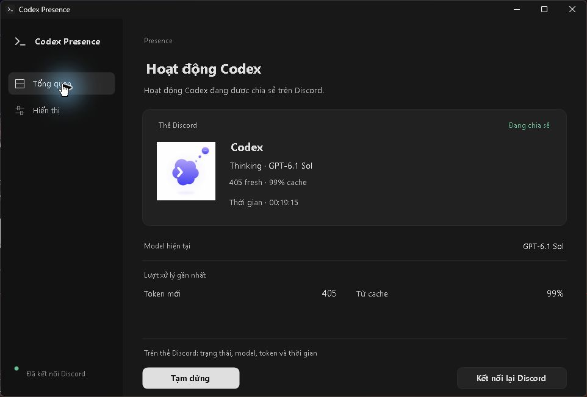

# Codex Presence

A small native Windows utility that shows your local Codex desktop activity in Discord Rich Presence.



Built by Nguyễn Gia Huy. This is an independent personal project, not an official OpenAI or Discord application.

## Download

Visit **[giahuydevtrai.online](https://giahuydevtrai.online/#projects)** for the Windows download. The current distributed build is a portable **Windows x64** executable. Keep it in a writable folder, because preferences are saved next to the application.

The executable does not currently carry an Authenticode publisher signature. No installer, login, Discord token, or API key is required by the utility. The release currently has no embedded semantic version; the accompanying checksum identifies the distributed binary.

## What it does

- Shows an activity phase such as thinking, writing code, reading, searching, idle, or needing attention.
- Optionally shows the current model and the latest turn's token/cache figures.
- Shows elapsed time for the detected Codex desktop session.
- Offers animated artwork, static artwork, and a compact token-focused card.
- Provides a Discord card preview, pause/resume, reconnect, and opt-in launch at Windows sign-in.
- Runs in the Windows notification area. Opening it again brings the existing instance to the foreground.

Activity is inferred from local session events; it can lag behind Codex and depends on Codex's log format. Token figures describe the latest recorded turn, not a bill or lifetime total. Fresh tokens are calculated as input tokens minus cached input tokens plus output tokens; the cache percentage uses input plus output as its denominator.

## Use

1. Open the **Discord desktop app**, sign in, and enable activity sharing in Discord if it is disabled.
2. Open the **Codex desktop app** on the same Windows account and start a task.
3. Run `CodexDiscordPresence.exe`. Wait for the connection state and preview to update.
4. Use **Hiển thị** to choose the model/artwork/card options. **Tạm dừng** clears the published activity; **Kết nối lại Discord** retries the connection.
5. Use the notification-area menu to exit the utility. Windows startup is optional and disabled unless you turn it on.

The current app detects the Microsoft Store Codex desktop package. It does not target Codex CLI sessions or Discord in a browser. If the card does not appear, check that both desktop apps are open, activity sharing is enabled, and Presence is not paused.

## Privacy and connections

The reader inspects records under the current user's `.codex/sessions` folder. Its output contains only activity phase, model, timestamps, and token counts. The Discord activity payload does not include prompts, responses, project names, file paths, commands, account identifiers, API keys, or credentials.

Presence communicates with Discord through its local named-pipe IPC. Discord publishes the selected activity using its normal service. Animated image URLs point to public, revision-pinned artwork on GitHub. Settings are written to `presence-settings.json` beside the executable; that local file is excluded from this repository.

## Build from source

Use Windows x64 with **.NET Framework 4.8** available. The build uses the framework compiler provided by Windows; it does not download NuGet packages or require a separate .NET SDK.

```powershell
./build.ps1
```

The application is written to `build/CodexDiscordPresence.exe`. The script compiles the four files in `src` and embeds the bundled icon and three GIFs.

To compile and run the isolated checks:

```powershell
./build.ps1 -Check
```

The checks use synthetic session records and private local test pipes. They cover reader selection/state handling, token arithmetic, card settings, RPC acknowledgements, PING/PONG, clearing activity, and disconnect recovery. They do not launch the application or publish to your real Discord account. Generated output and fixtures stay under the ignored `build` directory.

## Source layout

| Path | Purpose |
| --- | --- |
| `src/Core.cs` | Tray lifecycle, preferences, card composition, startup shortcut, controller |
| `src/ActivityReader.cs` | Bounded reader for local Codex desktop session events |
| `src/DiscordConnection.cs` | Discord local IPC client |
| `src/PresenceWindow.cs` | Native Windows Forms interface and controls |
| `tests` | Reader fixtures and local IPC checks |
| `assets` | Embedded icon and revision-pinned animated artwork |
| `docs/codex-presence.jpg` | Screenshot of the implemented application |
| `checksums.sha256` | SHA-256 of the original distributed Windows executable |

The original Windows executable is not checked into source control. Rebuilding may produce a different binary hash because compiler output includes build-specific metadata.

## Credits and licensing

Animated artwork comes from [SSHdotCodes/codex-rpc](https://github.com/SSHdotCodes/codex-rpc), pinned to revision `386660f2658773c5913f2d0b2a545017d2dcec43`, under the MIT license. See [THIRD_PARTY_NOTICES.md](THIRD_PARTY_NOTICES.md), [ARTWORK-LICENSE.txt](ARTWORK-LICENSE.txt), and `assets/LICENSE.txt`.

Codex, OpenAI, and Discord names and marks belong to their respective owners. Third-party artwork licensing does not license those trademarks. No separate open-source license has been selected for the project's own source code.

